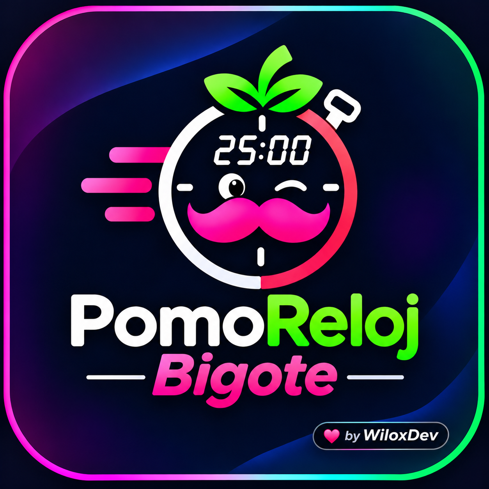

## 🚀 Instalación Canónica (Gentle-Shell)

> 🤖 **Para Instalación Asistida por AI (Claude, Pi, Cursor):** Consulta estrictamente [AI_INSTALL.md](AI_INSTALL.md) para garantizar el cumplimiento de la Invariante Zero-Chat y el correcto anclaje en el Sidebar Dock.

### Opción 1: Con el gestor nativo de Pi
`ash
pi install WiloxDev/Wellness-Reloj-pi
`

### Opción 2: Instalador local para Gentle-Shell
`ash
./install.sh
`

<div align="center">
  
  <h1>🍅 PomoReloj Bigote</h1>
  <p><b>Pomodoro + reloj y alertas ergonómicas (agua, vista 20-20-20 y pausas) en tu sidebar: porque pasar horas sentado programando no debe costarte la salud.</b></p>

[](https://gentlemanprogramming.com/gentle-hub/)
[](https://bit.ly/48zTJUo)
[](https://opensource.org/licenses/MIT)
[](https://github.com/WiloxDev/Wellness-Reloj-pi)
[](https://github.com/WiloxDev/Wellness-Reloj-pi)
[](https://gentlemanprogramming.com/gentle-hub/)

</div>

> 💬 **Comunidad y Soporte Oficial:** `wilox2` · [Servidor de Discord](https://bit.ly/48zTJUo)

---

```text
╭─── 🍅 PomoReloj Bigote ───────────────────╮
│   ╭─╮ ╭─╮   ╭─╮ ╭─╮                       │
│   │ │ ╶─┤ · ╰─╯ ╰─╯ PM   💧 Agua:   42m   │
│   ╰─╯ ──╯   ╰─╯   │      👀 Vista:  18m   │
│   Miércoles, 04 Nov      🚶 Pausa:  55m   │
╰───────────────────────────────────────────╯
```

---

## ✨ Características

- 🕒 **Reloj Digital 3x3**: Glifos redondeados de alta precisión ANSI (`╭─╮`, `│ │`, `╰─╯`) en formato 12h o 24h con fecha en español.
- 💧 **Monitor de Hidratación**: Temporizador decreciente configurable para recordar beber agua.
- 👁 **Regla 20-20-20 para la Vista**: Alertas de fatiga visual para cuidar tus ojos.
- 🧘 **Pausas Activas**: Temporizador para levantarse y estirarse.
- 🍴 **Agenda de Comidas**: Recordatorios dinámicos para Desayuno, Almuerzo, Merienda y Cena.
- 🛡 **A prueba de Actualizaciones**: Vive en el directorio de extensiones de usuario de Pi. Actualizar Gentle-Pi **nunca borra** ni rompe tu configuración.
- 🎨 **Totalmente Personalizable**: Tiempos, cronogramas y estilos modificables mediante `~/.wellnessrc.json`.

---

## 🤖 Instalación Rápida con Agente de IA

Si usas un asistente o agente de IA (Pi, Claude, Cursor, Copilot, etc.), solo cópiale este prompt:

```text
Instala la extensión Wellness & Reloj para Gentle-Pi ejecutando:
curl -fsSL https://raw.githubusercontent.com/WiloxDev/Wellness-Reloj-pi/main/install.sh | bash
Confírmame cuando esté montada en el sidebar derecho y dónde queda ~/.wellnessrc.json para personalizarla.
```

---

## 🚀 Instalación Rápida (1 Solo Comando)

Cualquier usuario de Gentle-Pi puede instalarlo con este comando en su terminal:

```bash
curl -fsSL https://raw.githubusercontent.com/WiloxDev/Wellness-Reloj-pi/main/install.sh | bash
```

O clonándolo directamente en la carpeta de extensiones de Pi:

```bash
git clone https://github.com/WiloxDev/Wellness-Reloj-pi.git ~/.pi/agent/extensions/wellness-reloj
cd ~/.pi/agent/extensions/wellness-reloj
npm install && npm run build
```

---

## ⚙️ Personalización (`~/.wellnessrc.json`)

El instalador genera automáticamente tu archivo de configuración en tu carpeta de usuario (`~/.wellnessrc.json`). Puedes editarlo en cualquier momento:

```json
{
  "clock": {
    "format": "12h",           // "12h" o "24h"
    "locale": "es",            // "es" o "en"
    "asciiStyle": "rounded",   // "rounded" o "square"
    "showDate": true
  },
  "habits": {
    "waterMinutes": 45,        // Cada cuánto recordar agua
    "eyeRestMinutes": 20,      // Descanso visual
    "stretchMinutes": 60,      // Pausa activa / estiramiento
    "resetOnClick": true       // Clic sobre la tarjeta reinicia los contadores
  },
  "schedule": {
    "breakfast": "08:30",
    "lunch": "13:30",
    "afternoonSnack": "17:00",
    "dinner": "21:00",
    "rest": "23:00"
  },
  "appearance": {
    "layout": "auto"           // "auto" (conmuta según ancho), "side-by-side" o "stacked"
  }
}
```

---

## 🕹 Comandos en Gentle-Shell & Pi

Dentro de la consola dispones de los comandos nativos `/pomoreloj` (o `/pomo`) y `/wellness` (alias retrocompatible):

- `/pomoreloj reset` (o `/pomo reset`) — Reinicia todos los temporizadores a cero de un solo golpe.
- `/pomoreloj water` (o `/pomo water`) — Reinicia el contador de agua e hidratación.
- `/pomoreloj eyes` (o `/pomo eyes`) — Reinicia el contador de descanso visual (regla 20-20-20).
- `/pomoreloj stretch` / `/pomo pausa` — Reinicia el contador de pausa activa y postura.
- `/pomoreloj doctor` — Auditoría rápida del estado y tiempos restantes en pantalla.
- *Tip ergonómico*: También puedes hacer **1-clic con el ratón** directamente sobre la tarjeta en el sidebar para resetear todos los hábitos al instante.

---

## 📦 Arquitectura y Desarrollo

```bash
# Compilar cambios de TypeScript
npm run build

# Modo watch durante desarrollo
npm run watch
```

## 📄 Licencia

MIT © [WiloxDev](https://github.com/WiloxDev)
